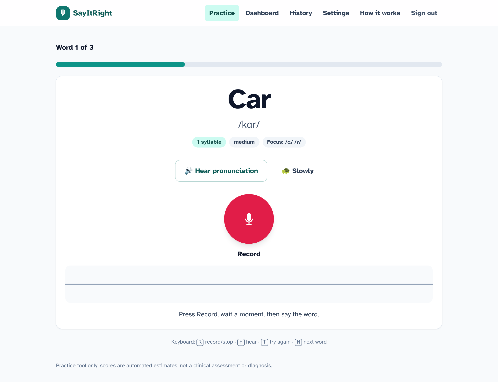
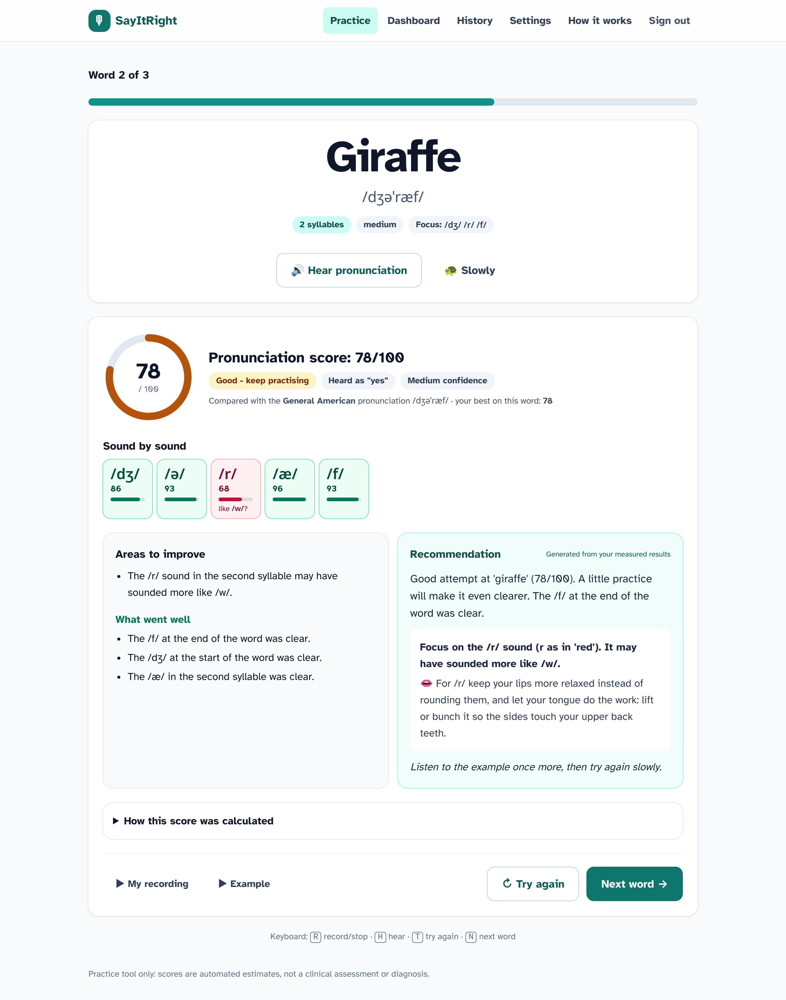
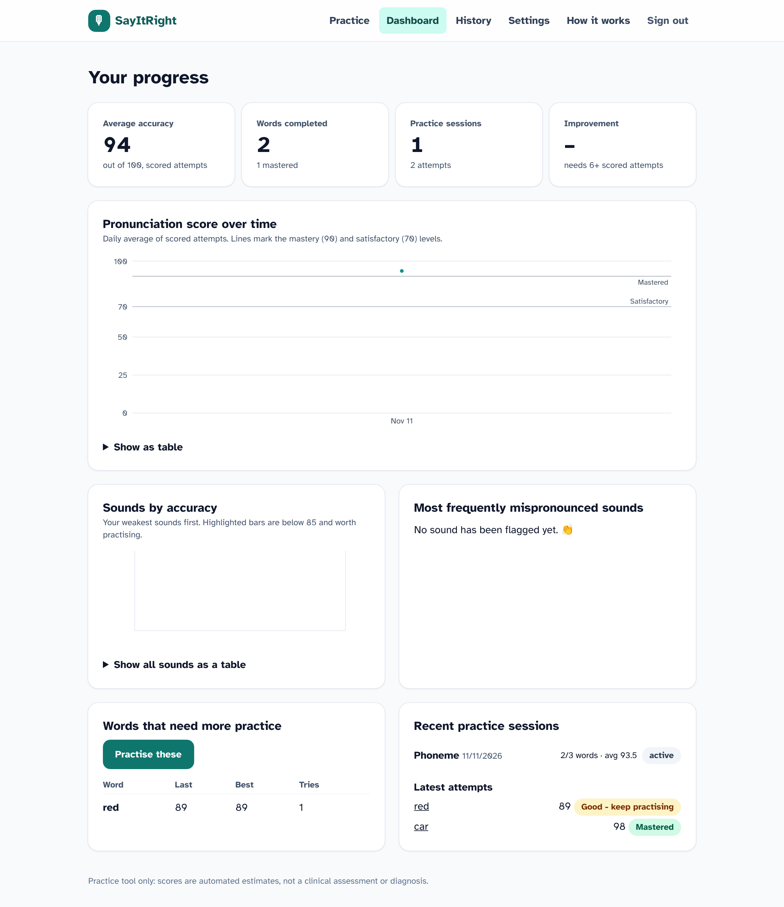

# SayItRight: AI-assisted pronunciation practice

A web application for practising English pronunciation word by word. The app
shows a word, plays a reference pronunciation, records the user, compares the
recording with standard recordings using **signals-and-systems analysis** (FFT,
MFCCs, energy, pitch, dynamic time warping), scores it 0-100, shows which part
of the word differed, and adapts the next words to the user's results.

> **Not a medical device.** Scores are automated practice estimates. The signal
> scorer was checked on generated voices, and the optional phoneme model against
> expert ratings of *non-native* speech (see [docs/validation.md](docs/validation.md)),
> but nothing here is **clinically validated**, and the app must not be used to
> diagnose speech or language conditions.

| Exercise | Results with part-by-part feedback | Progress dashboard |
|---|---|---|
|  |  |  |

## What works today

| Area | Status |
|---|---|
| Word display, reference audio (neural TTS / human recordings / browser fallback), recording with live waveform and silence auto-stop | Working |
| Recording quality gate (silence, too quiet, clipping, noise, cut-off): asks to re-record instead of scoring | Working, tested |
| **Signals-and-systems scoring (default)**: filters, FFT and MFCCs, energy, zero-crossing rate, autocorrelation pitch; DTW alignment against standard recordings; part-by-part similarity; minimal-pair checks for common mistakes; word identification by template matching; configurable weights | Working; calibrated and validated on generated voices: word identification 78%, common mistakes AUC 0.74 |
| Accent tolerance (standards for US/UK/dictionary pronunciations) | Working, tested |
| Optional neural phoneme model (Allosaurus + substitution/deletion-aware CTC GOP, `dev.py setup --ml`, `SA_ENGINE=allosaurus`) | Working, **validated on speechocean762** |
| AI feedback grounded in measured issues (Claude, or local Ollama), rule-based fallback, guardrails | Working; LLM path unit-tested with stubs (no API key in dev environment) |
| Adaptive sessions, practice modes, progress tracking, dashboard, history | Working, tested |
| Accounts (JWT), consent-gated recording storage, data export/deletion | Working, tested |
| wav2vec2 phoneme engine | Implemented, **not validated** (model hub unreachable in the dev environment) |

## Quick start

### Option A: Docker (one command)

```bash
docker compose up --build
```

Open http://localhost:8080 (API docs at http://localhost:8000/docs). The first build
downloads the reference voices; the first start generates every word's standard
recordings in the background (a few minutes). For the optional phoneme model add
`INSTALL_ML=true` (~1.5 GB more).

### Option B: Local development (Windows, macOS, Linux)

Requirements: Python 3.12 (3.11 works too; Windows needs 3.11 or 3.12) and Node.js 22.12+. Step-by-step guides:
[macOS](docs/development_guide.md#macos-apple-silicon-or-intel) (use `python3.12` below) and
[Windows](docs/development_guide.md#windows) (use `py -3.12` below). Then:

```bash
python scripts/dev.py setup      # venv, Python + Node packages, reference voices, database (--ml: optional phoneme model)
python scripts/dev.py backend    # http://localhost:8000
python scripts/dev.py frontend   # http://localhost:5173 (in a second terminal)
```

`scripts/dev.py` is a cross-platform task runner (`make <target>` works too on
macOS/Linux). See [docs/development_guide.md](docs/development_guide.md) for manual
steps, running each service on its own, and the frontend **mock mode** that needs
no backend.

### Enable AI-written feedback (optional)

Without an LLM the app uses deterministic, rule-based feedback built from the
same measured issues. To use Claude, set in `.env`:

```bash
LLM_PROVIDER=anthropic
ANTHROPIC_API_KEY=your-key-here
# LLM_MODEL defaults to claude-opus-5-5
```

Or run a free local model with [Ollama](https://ollama.com): `LLM_PROVIDER=ollama`,
`OLLAMA_MODEL=llama3.1:8b`. The Claude provider uses structured JSON output and
server-side refusal fallbacks (`fallbacks: "default"`).

## How scoring works (short version)

The default engine uses no speech-recognition model: the recording and the **standards** (generated
voices for every accepted pronunciation, plus human recordings if you add them) go through the same
signal processing and are compared.

1. **Quality gate.** Recordings that are silent, too quiet, clipped, noisy or cut off are rejected with a specific message.
2. **Front end.** High-pass filter (removes hum), 25 ms Hamming frames every 10 ms, FFT. Per frame: MFCCs
   with cepstral mean/variance normalisation (cancels the microphone's filter), loudness, zero-crossing
   rate, band energies, and pitch by autocorrelation.
3. **Alignment.** Dynamic time warping lines the recording up with each standard, so speaking rate is not
   an error; a small frequency-warp search adapts to voice size (children and adults). The closest
   standard is used, which also gives accent tolerance.
4. **Measures.** Spectral distance along the alignment, loudness-contour correlation, pitch contour, number
   of syllables (loudness peaks) and timing, plus a similarity for each syllable (or start / vowel / end).
5. **Minimal pairs.** Standards of common mistakes ("wabbit" for "rabbit") in the same voices: if the
   recording is clearly closer to a mistake than to the word, that mistake is named.
6. **Score** = 45% spectral similarity + 20% minimal-pair check + 15% loudness contour + 5% pitch contour
   + 5% syllables + 10% timing (configurable), with the same rating rules as before.
7. **Which word?** The recording is ranked against every practice word's standards; if another word wins,
   confidence drops and the result says so.

On generated voices not used as standards (675 correct and 948 mispronounced recordings of all
135 words): word identification **78%** (top 3: 90%); common mistakes **AUC 0.74**,
named in 43% of mistaken recordings, wrongly named for 5% of correct ones; other mistakes
AUC 0.59. Real voices will be harder. The optional phoneme model reaches AUC 0.91 on expert-rated
non-native speech (speechocean762). Details, limitations and how to rerun: [docs/validation.md](docs/validation.md).

## Repository layout

```
frontend/          React + TypeScript + Vite + Tailwind + Recharts (UI team)
backend/           FastAPI, SQLAlchemy, Alembic, auth, sessions, progress (backend team)
speech_analysis/   audio processing, signal analysis, optional phoneme engines, scoring, TTS (speech team)
ai_feedback/       prompts, LLM providers, guardrails, articulation knowledge base (AI team)
data/              word database (words.json, built from data/source/words.csv)
docs/              architecture, API, development, deployment, validation, roadmap, tasks
e2e/               browser end-to-end test (Playwright, fake microphone)
scripts/           setup, model download, evaluation, calibration, word DB build
.github/           CI workflows, issue and PR templates
```

## Documentation

- [docs/architecture.md](docs/architecture.md): components, data flow, scoring pipeline, database
- [docs/api_documentation.md](docs/api_documentation.md): endpoints, schemas, errors
- [docs/development_guide.md](docs/development_guide.md): setup, testing each module, migrations
- [docs/deployment.md](docs/deployment.md): configuration per environment, production checklist
- [docs/validation.md](docs/validation.md): evaluation method and results
- [docs/roadmap.md](docs/roadmap.md) and [docs/task_breakdown.md](docs/task_breakdown.md): planning
- [TEAM_GUIDE.md](TEAM_GUIDE.md) and [CONTRIBUTING.md](CONTRIBUTING.md): how the team works

## Licences and attribution

The project licence has not been chosen yet. Third-party components and their licences
(Allosaurus GPL-3.0, Piper voices CC BY 4.0, CMUdict BSD, speechocean762 CC BY 4.0, ...) are
listed in [THIRD_PARTY.md](THIRD_PARTY.md). Check them before distributing builds.
