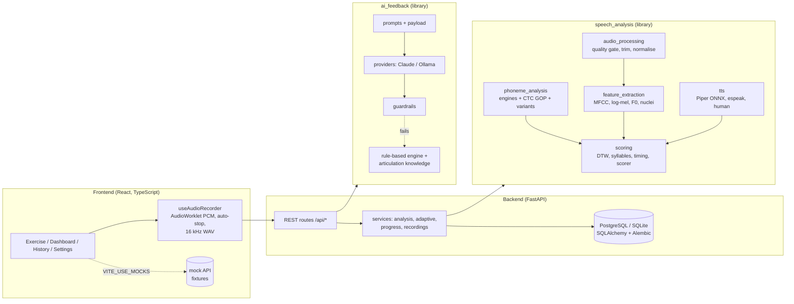
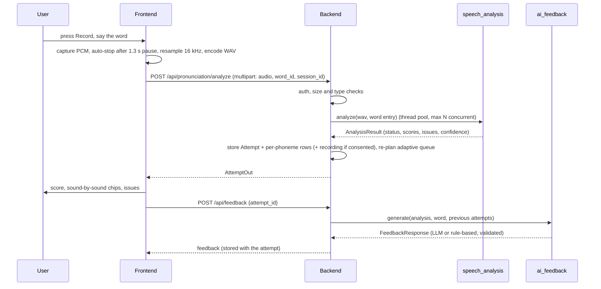
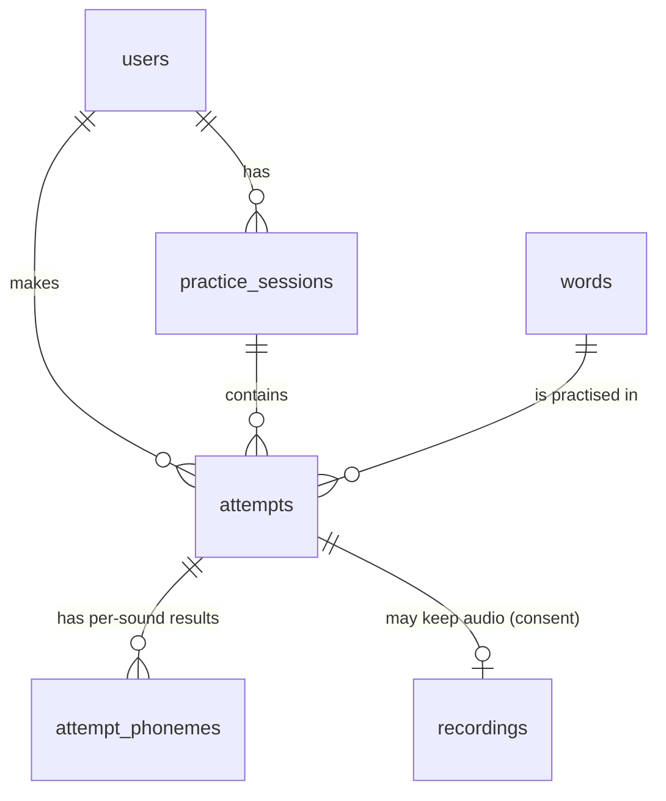

# Architecture

## Components



Each box is independently testable: `speech_analysis` and `ai_feedback` have
no web or database dependencies; the backend talks to them through two
functions (`PronunciationAnalyzer.analyze`, `FeedbackService.generate`); the
frontend talks to the backend only through the OpenAPI contract and can run on
mocks.

## Request flow: one attempt



Feedback is a separate call so the score appears immediately while the LLM writes tips.

## Analysis pipeline

Two engines share the audio processing and quality gate (step 1):

* **Signal analysis (default, `SA_ENGINE=signal`)**: signals-and-systems comparison of the recording with
  standard recordings; no speech-recognition model. Described in the next section.
* **Phoneme model (optional, `SA_ENGINE=allosaurus`, needs `dev.py setup --ml`)**: steps 2-5 below; kept to
  compare against the signal analysis.

### Signal analysis (`speech_analysis/signal_analysis`)

1. **Front end** (`dsp.py`, `features.py`), the same for the recording and every standard: zero-phase
   Butterworth high-pass (70 Hz, removes DC and hum) -> 25 ms Hamming frames every 10 ms -> FFT power
   spectrum. Per frame: short-time energy, zero-crossing rate, spectral centroid, energy in four bands
   (80-500, 500-1500, 1500-3500, 3500-8000 Hz), pitch by autocorrelation (computed with the FFT,
   Wiener-Khinchin), and MFCCs (pre-emphasis, 40 mel filters, log, DCT) with cepstral mean/variance
   normalisation, which cancels a microphone's linear filter. The comparison vector per frame is MFCC
   c1-c12 + their deltas + loudness relative to the loudest frame.
2. **Standards** (`standards.py`): human recordings in `data/reference_audio/` when present, plus Piper
   voices (3 voices x every pronunciation variant) for every word, generated once and cached.
3. **Alignment** (`compare.py`): dynamic time warping with a Sakoe-Chiba band, searched over 7 frequency-warp
   factors (vocal tract length normalisation), so speaking rate and voice size are not counted as errors.
   The standard that explains the recording best (overall distance + half the worst part's) is used, which
   gives accent tolerance.
4. **Measures** along the aligned path: spectral distance (mean frame distance), loudness-contour
   correlation, pitch contour (RMS semitone difference, each relative to its own median), syllable count
   (voiced peaks of 300-2500 Hz energy), duration ratio and rhythm (spread of the warping path's slope).
5. **Parts** (`segments.py`): the standard is split into syllables at the energy dips between syllable
   nuclei (start / vowel / end for one-syllable words); each part gets its own spectral similarity,
   relative duration, loudness and 3.5-8 kHz (hiss) difference, which drive the feedback.
6. **Minimal pairs** (`minimal_pairs.py`): standards of common mistakes ("wabbit", "poon", /th/ for /s/ ...)
   in the same voices. `d(correct) - d(mistake)`, averaged over voices, cancels most of the voice difference;
   a calibrated logistic turns it into the probability of that mistake, which names the mistake in the
   feedback when it is likely.
7. **Word identification**: the recording is compared with the standards of every practice word (template
   matching, with a penalty per syllable of difference); the rank of the target word sets a confidence
   factor and the "Matched the word" badge.
8. **Score** (`report.py`): weighted mean of spectral similarity 45%, minimal-pair check 20%, loudness
   contour 15%, pitch contour 5% (2+ syllables), syllables 5%, timing 10%; the same rating rules and score
   caps as the phoneme scorer, with parts in place of sounds. Calibration and validation:
   `scripts/calibrate_signal.py`, results in [validation.md](validation.md#signal-analysis-default-engine).

### 1. Audio processing (`speech_analysis/audio_processing`)
- Decoding: WAV/FLAC/OGG via libsndfile; WebM/MP4/MP3 via ffmpeg if installed. Resampled to 16 kHz mono.
- Energy VAD with an adaptive threshold (`max(noise floor + 6 dB, peak - 32 dB)`), gap filling
  (stop closures) and island removal; speech region = first to last speech frame.
- Quality gate (`QualityThresholds`, configurable): duration, speech duration, level (< -45 dBFS -> too quiet),
  clipping (> 1% of samples), SNR estimate (< 15 dB rejected, < 25 dB lowers confidence), and
  truncation (speech active in the first or last 40 ms). Blocking issues return `retry_required`.
- Two outputs: tightly trimmed, loudness-normalised speech (80 ms padding) for DTW/timing, and the same
  gain with 0.3 s of real context for the phoneme model (initial consonants are recognised much better
  with leading context).

### 2. Features (`speech_analysis/feature_extraction`)
MFCC c1-c12 + deltas with per-utterance CMVN; log-mel; F0 by probabilistic YIN (65-600 Hz, adults and
children); RMS energy; syllable nuclei as voiced peaks of 300-2500 Hz energy (de Jong & Wempe style).

### 3. Phoneme-level GOP (optional engine)
Engine interface: `PhonemeEngine.assess(audio, variants, vocabulary, target_word) -> EngineOutput`.
The default engine (Allosaurus `eng2102`) outputs CTC log posteriors over 38 English phones; ARPAbet
labels map to *units* (diphthongs are two symbols, e.g. /aɪ/ = `a j`).

For canonical units `c = c_1..c_N` and every position `i`:

```
P(c_i | X) = P_ctc(c | X) / ( P_ctc(c | X) + sum_q P_ctc(c[i->q] | X) + P_ctc(c[i->{}] | X) )
```

where `P_ctc` is the CTC forward likelihood (all alignments), `c[i->q]` substitutes unit `i` with each of
the 40 candidate phones and `c[i->{}]` deletes it (Cao et al., Interspeech 2024; cf. Witt & Young 2000).
This is computed for all substitutions in one batched forward pass (`ctc_gop.py`, NumPy; PyTorch's
`ctc_loss` for large batches; verified against brute-force path enumeration in tests).
Outputs per phone: posterior, best competing phone ("may have sounded like /w/"), deletion probability,
approximate time span (Viterbi alignment).

**Accent tolerance.** Every word variant (General American, CMUdict alternates, British RP) is scored and
the best-explained one used. Context rules in `variation.py` add accepted realisations: cot-caught merger
(AA~AO), unstressed vowel reduction (ə~ɪ), happy-tensing, flapped /t/~/d/ between vowels. Rules are
conservative: /w/ for /r/ is never accepted.

**Word recognition** (supplementary): CTC likelihood of every practice word's pronunciations; the best
one is `recognized_word`. This is *not* used for the score.

### 4. Supporting measures (`speech_analysis/scoring`)
- **Acoustic similarity**: DTW (anti-diagonal vectorised, Sakoe-Chiba band 0.35) on CMVN MFCCs against
  Piper references of the matched variant (several voices), with a vocal-tract-length warp search
  (factors 0.88-1.12). Cost -> similarity via a calibrated logistic.
- **Syllable completeness**: 0.7 x fraction of vowels present (model) + 0.3 x acoustic nucleus count (+/-1).
- **Temporal**: duration ratio vs. reference (no penalty from 0.7x to 2.2x: slow careful speech is fine)
  and DTW local-tempo spread.

### 5. Scoring (`scorer.py`)
- Phone score = per-phone calibrated expected expert rating (0-100).
- Phoneme accuracy = word-level calibration of phone scores (expected expert word rating).
- Overall = weighted mean over available components (default 0.6 / 0.2 / 0.1 / 0.1, renormalised).
- Status per phone: good >= 85, fair >= 70, poor < 70, missing (deletion most likely).
- Rating: mastered (>= 90 and every sound good), needs practice (< 70 or a sound < 60), else satisfactory.
  The overall score is capped to stay consistent with the label (configurable `cap_scores`).
- Confidence = product of recording quality, model availability, consistency between word recognition and
  phone scores, and duration plausibility (a documented heuristic). Below 0.35 -> `inconclusive` (no score).
- Issues are generated from measured evidence only and carry stable IDs (`ph0-substitution`, ...).

All thresholds live in `speech_analysis/config.py` and can be overridden by environment variables or a
JSON file; none of them is a clinical standard.

## AI feedback (`ai_feedback`)
1. `build_payload` sends only measured data plus curated articulation notes for the flagged sounds.
2. The provider (Claude via the Anthropic SDK with JSON-schema structured output and refusal fallbacks,
   or Ollama) returns `{summary, recommendations[{issue_id, tip, articulation}], encouragement, progress_note}`.
3. Guardrails drop tips that cite unknown issue IDs, mention sounds that were not measured, or use
   diagnostic language; progress claims must match the score change.
4. If the LLM fails or nothing grounded remains, the rule-based engine produces the feedback
   (`source: rule_based`). Unscored attempts never reach the LLM.

## Adaptive practice (`backend/services/adaptive.py`)
Phoneme weakness = exponentially weighted mean phone score (14-day half-life) shrunk toward a neutral
85 with 3 pseudo-observations, mapped to 0..1. Word priority = 1 + 3 x (weakness of its two weakest sounds
+ 0.5 x weakness of its target sounds), +0.6 for never-tried words, +1 if last rated needs practice,
-1.5 if mastered, -1 outside the difficulty band derived from the recent average. In adaptive sessions the
remaining queue is re-ranked after every scored attempt. Modes: adaptive, random, easy, medium, hard,
one sound, words to improve.

## Data model



`attempts.analysis` stores the full `AnalysisResult` JSON (auditable); `attempt_phonemes` is denormalised
for fast progress queries. Deleting a user cascades to everything; recording files are deleted with rows.

## Security and privacy
- Passwords: scrypt (n=2^14, r=8, p=1) with per-user salt; JWT HS256 access tokens; production refuses
  short secrets and SQLite.
- Uploads: content-type allow-list, magic-byte check, 2 MB limit, server-generated file names.
- Every attempt/session/recording lookup checks ownership (404 for other users' objects).
- Recordings are stored only when the user opted in; export, per-recording and bulk deletion endpoints.
- API keys only via environment variables; `.env` is git-ignored.
- The browser recorder disables noise suppression/AGC to avoid distorting speech; microphone access
  requires HTTPS outside localhost.

## Replacing a component
- **New phoneme model:** implement `PhonemeEngine` (or subclass `CTCPhonemeEngine` and provide
  `log_posteriors` + label->token units), register it in `engines/__init__.py`, run the validation and
  calibration scripts, ship the calibration JSON. Nothing else changes.
- **New LLM:** implement `generate(system, user, schema) -> str` in `ai_feedback/providers/`.
- **Different scoring weights or thresholds:** configuration only.
