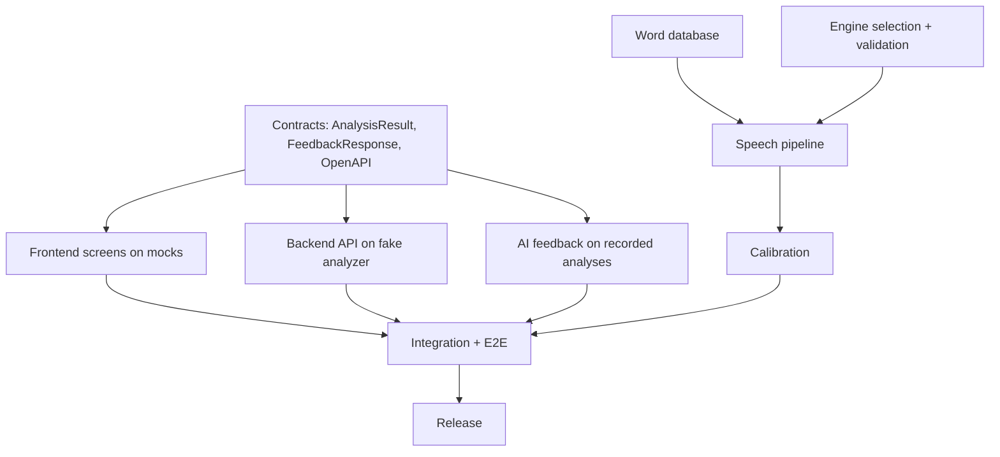
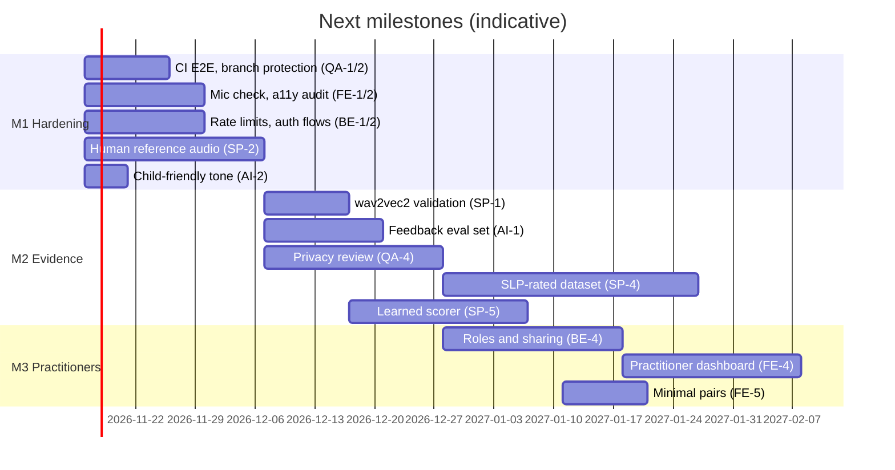

# Roadmap and parallel development plan

## Where we are (v0.1.0)

The core workflow works end to end and is tested: word -> hear -> record -> analyse (phoneme GOP,
validated on speechocean762) -> score -> grounded feedback -> next word, plus adaptive sessions,
dashboard, history, privacy controls, CI and Docker. See the status table in the README.

## How the original build was parallelised

The architecture was designed so these streams only meet at contracts:

| Can start immediately (parallel) | Depends on |
|---|---|
| Frontend UI with mock API | contract only |
| Backend auth, sessions, persistence | contract only (fake analyzer) |
| AI prompts, guardrails, knowledge base | contract + a few recorded analyses |
| Word database | nothing |
| Speech engine evaluation | dataset access |
| Calibration | engine choice |
| Integration / E2E | all of the above |

## Next milestones

Full task list with owners, sizes and dependencies: [task_breakdown.md](task_breakdown.md).
